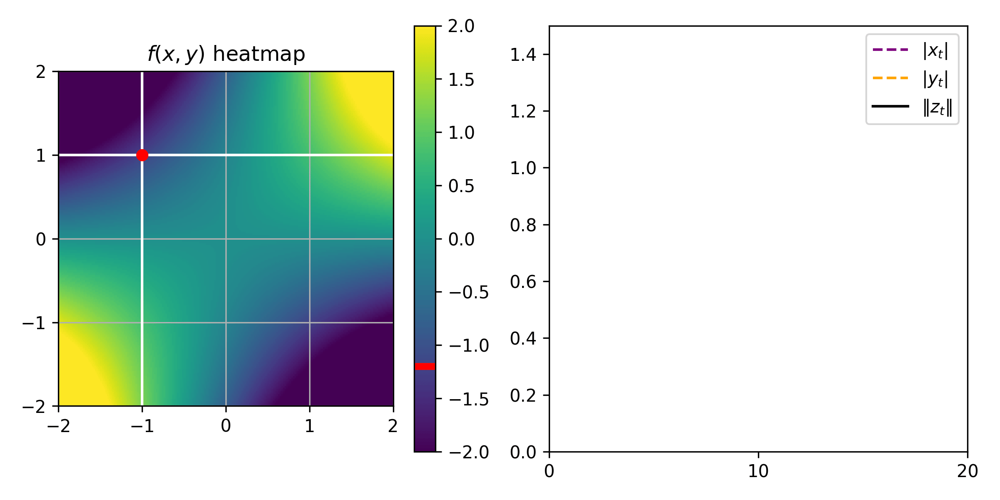
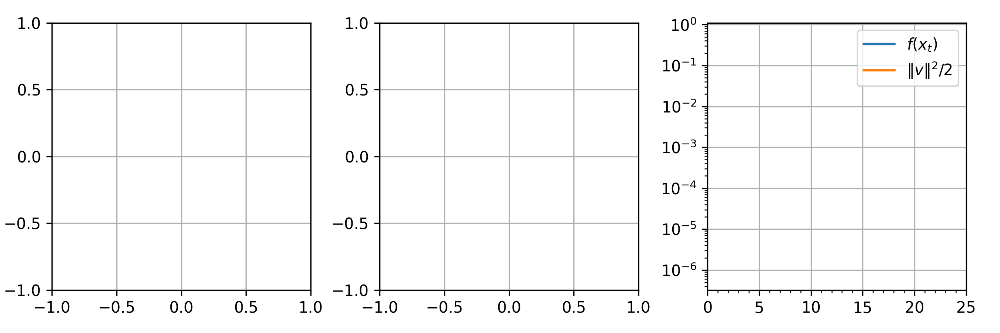
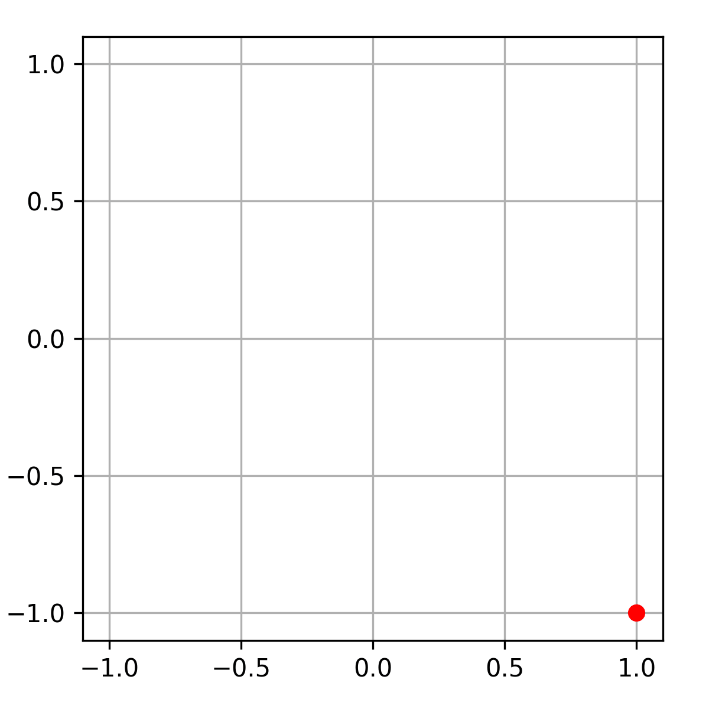
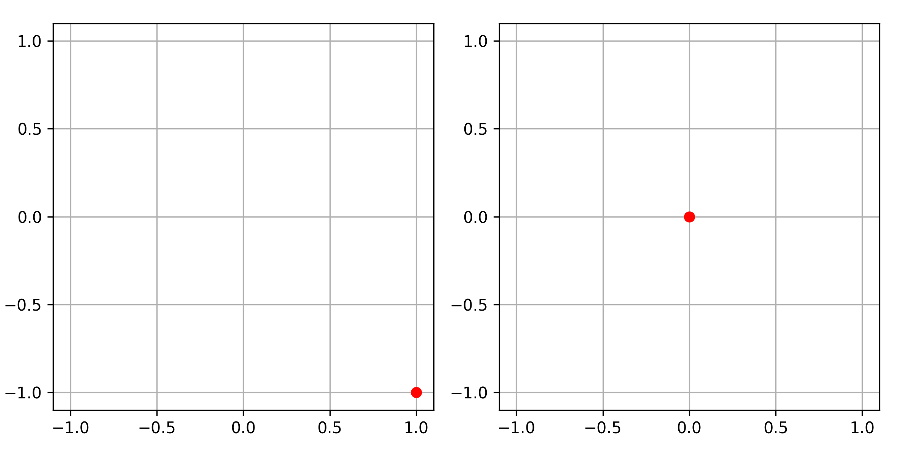

This is the continuation of my previous blog post about hypocoercivity.
If you haven't already, I would recommend starting with the [first
part](/posts/hypocoercivity1/).
Recall that:

-   We call a matrix $M$ hypocoercive if the linear dynamical system
    $\dot{x}_t = -M x_t$ converges to $0$ exponentially, i.e.,
    $\left\lVert x_t \right\rVert \leq C e^{-\alpha t} \left\lVert x_0 \right\rVert$
    for some $C, \alpha>0$ for any $x_0$.

-   We denote the optimal exponential convergence rate by $\alpha(M)$,
    and it is characterized by
    $\alpha(M) = \min_{\lambda \in \mathrm{Sp}(M)} \Re(\lambda)$ where
    $\mathrm{Sp}(\cdot)$ denotes the set of eigenvalues.

-   If $S$ is symmetric positive-semi-definite (PSD), and $A$ is
    antisymmetric, then $M=S+A$ is hypocoercive if and only if no
    non-zero eigenvector of $A$ lies in $\mathop{\mathrm{Ker}}S$
    (Kawashima's condition).

For a complex matrix or vector $P \in \mathbb{C}^{d_1 \times d_2}$, I
will write indifferently $P^*$ or $\overline P^\top$ for the conjugate
transpose.

In this second part, the goal is to review three situations of interest
for machine learning where hypocoercivity comes up.

# Gradient descent-ascent for min-max optimization

Consider a min-max optimization problem
$\min_{x \in \mathbb{R}^{d_x}} \max_{y \in \mathbb{R}^{d_y}} f(x, y)$.
That is, we look for a couple $(x^*, y^*)$ such that
$x^* = \mathop{\mathrm{arg\,min}}f(\cdot, y^*)$ and
$y^* = \mathop{\mathrm{arg\,max}}f(x^*, \cdot)$ (we assume that such a
couple exists). The simplest algorithm to do this is gradient
descent-ascent; let's focus on its continuous-time limit, which is the
ODE $$\begin{pmatrix}
        \dot{x}_t \\
        \dot{y}_t
    \end{pmatrix}
    = \begin{pmatrix}
        -\nabla_x f(x_t, y_t) \\
        \nabla_y f(x_t, y_t)
    \end{pmatrix}.$$ To simplify even further, let's assume $f$ is
quadratic: $f(x, y) = \begin{pmatrix}
    x \\ y
\end{pmatrix}^\top
\begin{bmatrix}
    Q & P \\
    P^\top & -R
\end{bmatrix}
\begin{pmatrix}
    x \\ y
\end{pmatrix}$ with $Q$ and $R$ symmetric w.l.o.g. Then the above ODE is
linear: $$\dot{z}_t = -M z_t
    ~~~~\text{where}~~~~
    z_t = \begin{pmatrix}
        x_t \\ y_t
    \end{pmatrix}
    ~~\text{and}~~
    M = \begin{bmatrix}
        Q & P \\
        -P^\top & R
    \end{bmatrix}.$$ Additionally, let's assume $Q$ and $R$ are PSD,
because that's the necessary and sufficient condition for the existence
of $(x^*, y^*)$. For simplicity, let's also assume $M$ is invertible,
which is the necessary and sufficient condition for $(x^*, y^*)$ to be
unique; in this case $(x^*, y^*) = (0, 0)$.

::: {#fig}
{width="80%"}
:::

The two most urgent questions in this setting, from an optimization
point of view, are

::: bigquote
Does the gradient descent-ascent flow ODE converge to $(x^*, y^*)$ (*qualitatively*)?\
If yes, what is the convergence rate (*quantitatively*)?
:::

This is equivalent to asking about the convergence of the linear
dynamical system $\dot{z}_t = -M z_t$, and so, about the hypocoercivity
of $M$.

-   For the qualitative question, thanks to the assumptions, the
    symmetric part of $M$ is PSD, so we can apply Kawashima's condition.
    We end up with a necessary and sufficient condition involving the
    singular vectors of $P$ and the kernel of $Q$ and $R$, left as an
    exercise.

-   For the quantitative question, we know that the convergence is
    exponential with rate $\alpha(M)$ by definition, but this quantity
    is not really explicit: it depends on $Q, P$ and $R$ in a
    complicated way. Getting explicit lower bounds on $\alpha(M)$ is
    really tricky, and the only convincing result I know of (outside of
    the coercive case) is the following. [^1]

::: {#prp-gda .proposition}
## [@nagarajan2017gradient, Appendix G] [@zhang2022near, Theorem 6]

Consider the block matrix $M = \begin{bmatrix}
        Q & P \\
        -P^\top & R
    \end{bmatrix} \in \mathbb{R}^{(d_x+d_y) \times (d_x+d_y)}$ where
$Q, R$ are symmetric positive-semi-definite. If
$R \succeq \beta I_{d_y}$ and $P$ is full-row-rank (i.e., wide and
full-rank) then $$\alpha(M) = 
        \min_{\lambda \in \mathrm{Sp}(M)} \Re(\lambda) \geq \min\left( \frac{\beta}{2}, \frac{\sigma_{\min}(PP^\top)}{\sigma_{\max}(R)} \right).$$
:::

::: {.callout collapse="true"}
## Proof (click to reveal).

Here is a proof for the case $Q=0$. For the case where $Q$ is
only PSD, see [@zhang2022near].

Let $M z = \lambda z$ an eigenvalue/vector pair, with
$\lambda \in \mathbb{C}$, $z = \begin{pmatrix}
        x \\ y
    \end{pmatrix} \in \mathbb{C}^{d_x+d_y}$ and
$\left\lVert x \right\rVert^2+\left\lVert y \right\rVert^2=1$. Written
more explicitly, $\begin{pmatrix}
        P y \\
        -P^\top x + R y
    \end{pmatrix}
    = \begin{pmatrix}
        \lambda x \\ 
        \lambda y
    \end{pmatrix}$. As an immediate consequence,
$z^* M z = \lambda = y^* R y + (x^* P y - y^* P^* x)$, so
$\Re(\lambda) = y^* R y \geq 0$.

Note that
$y^*P^* P y = \lambda y^* P^* x = \lambda y^* \left( R y - \lambda y \right) = \lambda \left( y^* R y - \lambda \left\lVert y \right\rVert^2 \right)$.
That is,
$$\lambda^2 - \frac{y^* R y}{\left\lVert y \right\rVert^2} \lambda + \frac{y^* P^* P y}{\left\lVert y \right\rVert^2} = 0.$$
In particular, taking the imaginary part, we have
$2\Re(\lambda) \Im(\lambda) = \frac{y^* R y}{\left\lVert y \right\rVert^2} \Im(\lambda)$,
so either $\lambda \in \mathbb{R}$ or
$\Re(\lambda) = \frac{y^* R y}{2 \left\lVert y \right\rVert^2} \geq \frac{\beta}{2}$.
Focus henceforth on the case $\lambda \in \mathbb{R}$.

Suppose $0 \leq \lambda<\beta$, so in particular $R - \lambda I_d$ is
invertible. We have $$\begin{aligned}
        -P^\top x + Ry &= \lambda y \\
%       (R-\lambda I_{d_y}) y &= P^\top x \\
        y &= (R-\lambda I_{d_y})^{-1} P^\top x \\
        \lambda x = Py &= P (R-\lambda I_{d_y})^{-1} P^\top x.
    \end{aligned}$$ So $\lambda$ is an eigenvalue of
$P (R - \lambda I_{d_y})^{-1} P^\top$. Now
$0 \preceq R - \lambda I_{d_y} \preceq \sigma_{\max}(R) I_{d_y}$, so
$P (R-\lambda I_{d_y})^{-1} P \succeq \sigma_{\max}(R)^{-1} P P^\top$,
so $\lambda \geq \sigma_{\max}(R)^{-1} \sigma_{\min}(P P^\top)$.
:::

# Accelerated gradient flows

For a function $f: \mathbb{R}^d \to \mathbb{R}$, consider the ODE system
$$\begin{cases}
    \dot{x}_t = v_t, \\
    \dot{v}_t = -\nabla f(x_t) - \gamma v_t.
\end{cases}$$ {#eq-AGF} 
Here the variable $x_t \in \mathbb{R}^d$ can be
thought of as the position in space of a particle, and
$v_t \in \mathbb{R}^d$ as its instantaneous velocity. In this
interpretation, the particle has mass $=1$ and follows Newton's second
law of motion (mass$\times$acceleration=force), and is subjected to two
kinds of forces: a conservative force with potential energy $f(x)$, and
a friction force proportional to velocity. So it is intuitive that
$(x_t, v_t)$ should converge to $(x^*, 0)$ as $t \to \infty$, where
$x^*$ is a local minimum of the potential energy $f$.

This intuition inspired optimizers to propose (discrete-time) algorithms
based on the ODE system (@eq-AGF), for minmization problems
$\min_{x \in \mathbb{R}^d} f(x)$. The most famous ones are Polyak's
heavy-ball method and Nesterov's accelerated gradient descent. In turn,
in order to analyze their convergence properties, some researchers have
turned back to studying the continuous-time limit of these algorithms
[@su2016differential]. The history of this idea is nicely explained in
[this blog post by Andre Wibisono](https://awibisono.github.io/2016/06/27/accelerated-gradient-flow.html).

Let us now focus on the ODE system
(@eq-AGF). To
simplify things, similarly to the previous example, let's assume $f$ is
quadratic, $f(x) = \frac12 x^\top H x$ with $H$ positive-definite; in
particular the only local minimum is $x^*=0$. Then we can rewrite
(@eq-AGF) as
$$\dot{z}_t = -M z_t
    ~~~~\text{where}~~~~
    z_t = \begin{pmatrix}
        x_t \\ v_t
    \end{pmatrix}
    ~~\text{and}~~
    M = \begin{bmatrix}
        0 & -I_d \\
        H & \gamma I_d
    \end{bmatrix}.$$ Again, the most urgent questions are: does this
dynamical system converge to $(x^*, 0)$? and if yes, what is the
convergence rate? This time, there is only one "unknown" matrix $H$, so
we can give a full characterization.

::: proposition
**Proposition 2**. *Let $H \in \mathbb{R}^{d \times d}$ be a symmetric
matrix, denote its spectrum by $\{ \lambda_1, ..., \lambda_d \}$, and
assume that $\beta \coloneqq \min_j \lambda_j >0$. Let
$M = \begin{bmatrix}
        0 & -I_d \\
        H & \gamma I_d
    \end{bmatrix}$. We have $$\mathrm{Sp}(M)
%       = \spectrum\left(
%       \begin{bmatrix}
%           0 & 0 \\
%           1 & 0
%       \end{bmatrix}
%       \otimes H
%       + \begin{bmatrix}
%           0 & -1 \\
%           0 & \gamma
%       \end{bmatrix}
%       \otimes I_d
%       \right)
        = \bigcup_{j \leq d} \mathrm{Sp}\left( \begin{bmatrix}
            0 & -1 \\
            \lambda_j & \gamma
        \end{bmatrix} \right)
        = \bigcup_{j \leq d}~ \{X_j^+, X_j^-\}$$
where $X_j^{\pm} = \frac{\gamma}{2} \pm \frac12 \sqrt{\gamma^2-4\lambda_j}$.
In particular, for $\gamma = 2 \sqrt{\min_j \lambda_j}$, the square-root
term in $X_j^\pm$ is imaginary for all $j$, and so
$\alpha(M) = \frac\gamma2 = \sqrt{\beta}$.*
:::

::: {.callout collapse="true"}
## Proof (click to reveal).
The proposition follows directly from the following lemma with $A = \begin{bmatrix}
        0 & 0 \\
        1 & 0
    \end{bmatrix}$, $B = \begin{bmatrix}
        0 & -1 \\
        0 & \gamma
    \end{bmatrix}$ and $X=H$:

::: {#lem-linalg .lemma}
For any matrix $A, B \in \mathbb{R}^{N \times N}$ and any
symmetric matrix $X \in \mathbb{R}^{D \times D}$,
$$\mathrm{Sp}(A \otimes X + B \otimes I_D)
    = \bigcup_{\lambda \in \mathrm{Sp}(X)} \mathrm{Sp}(\lambda A + B).$$
:::

We now turn to the proof of the lemma.
Let

- $X x_j = \lambda_j x_j$ ($1 \leq j \leq D$) be the
eigenvalue/vector pairs of $X$, and 

- for each $j$, let
$(\lambda_j A + B) e^j_k = \lambda^j_k e^j_k$ ($1 \leq k \leq N$) be the
eigenvalue/vector pairs of $\lambda_j A + B$. 

Then the $ND$ vectors
$z^j_k = e^j_k \otimes x_j \in \mathbb{R}^{ND}$ satisfy
$$(A \otimes X + B \otimes I_D) z^j_k = A e^j_k \otimes X x_j + B e^j_k \otimes x_j
        = (\lambda_j A e^j_k + B e^j_k) \otimes x_j
        = \lambda^j_k e^j_k \otimes x_j
        = \lambda^j_k z^j_k.$$ So the $z^j_k$ are the eigenvectors of
$A \otimes X + B \otimes I_D$, and the associated eigenvalues are the
$\lambda^j_k$.
:::

### Comparison with vanilla gradient flow

Gradient flow for the quadratic function $f(x) = \frac12 x^\top H x$ is
the ODE $\dot{x}_t = -\nabla f(x_t) = -H x_t$. Let's assume, as in the
proposition above, that the symmetric matrix $H$ is positive-definite,
and let $\beta \coloneqq \min \mathrm{Sp}(H) >0$. By decomposing the
gradient flow ODE in the eigenbasis of $H$, we see that
$\left\lVert x_t \right\rVert = \Theta(e^{-\beta t})$. [^2]

Thus, the exponential convergence rate of gradient flow is $\beta$,
while that of accelerated gradient flow
(@eq-AGF) is
$\sqrt{\beta}$ (for the optimal choice of friction coefficient), which
is much faster if $\beta \ll 1$! This insight continues to hold for
non-quadratic $f$'s, and for discrete-time versions of the dynamics. For
a full discussion, see the already mentioned [blog post by Andre
Wibisono](https://awibisono.github.io/2016/06/27/accelerated-gradient-flow.html).

::: {layout-nrow=2}
{width="66%"}

{width="100%"}
:::

# Underdamped Langevin dynamics

This last example is not finite-dimensional, despite this blog post's
title. It's the most classical PDE where we see a hypocoercivity
phenomenon, and it's also highly relevant in the context of sampling,
which is a common task in machine learning. So I decided to include a
brief discussion of it, though there would be much, much more to say.

### Background: the overdamped Langevin (OL) dynamics

Let $\nu = e^{-V(x)} \mathrm{d}x \in \mathcal{P}(\mathbb{R}^d)$ with $V$
smooth and satisfying appropriate growth conditions. The overdamped
Langevin dynamics (for an initial distribution $\mu_0$) is the
stochastic process given by the SDE
$$\mathrm{d}X_t = -\nabla V(X_t) \mathrm{d}t + \sqrt{2} \mathrm{d}B_t,$$
with $B_t$ a Brownian motion and $X_0 \sim \mu_0$. In many settings, all
we care about is the time-evolution of
$\mu_t \coloneqq \mathrm{Law}(X_t)$ (rather than path-wise properties of
the process), so in the sequel, I will refer to $(\mu_t)_t$ itself as
the overdamped Langevin dynamics. Namely, its evolution is described by
the PDE [^3]
$$\partial_t \mu_t = \nabla \cdot (\mu_t \nabla \log \frac{\mu_t}{\nu}).$$
It is often convenient to restate it in terms of
$\rho_t = \frac{\mathrm{d}\mu_t}{\mathrm{d}\nu}$, namely,
$$\partial_t \rho_t 
    = \frac{1}{\nu} \nabla \cdot (\nu \nabla \rho) 
    = \Delta \rho - \nabla \log V \cdot \nabla \rho.$$ There are several
natural metrics to measure the speed of convergence of OL:

-   Convergence in Wasserstein distance refers to $W_2^2(\mu_t, \nu)$
    going to $0$.

    -   If $\nu$ satisfies a so-called Talagrand inequality, then
        Wasserstein convergence implied by KL or $L^2$ convergence.

-   Convergence in Kullback-Leibler (KL) divergence refers to
    $\mathsf{KL}\left( \mu_t \middle\| \nu \right) = \int_{\mathbb{R}^d} \log(\frac{\mathrm{d}\mu_t}{\mathrm{d}\nu}) \mathrm{d}\mu_t$
    going to $0$.

    -   Since
        $\mathsf{KL}\left( \cdot \middle\| \cdot \right) \leq \chi^2\left( \cdot \middle\| \cdot \right)$,
        of course KL convergence is implied by $L^2$ convergence.

    -   If $\nu$ satisfies a so-called log-Sobolev inequality (LSI),
        then OL converges exponentially in KL.

-   Convergence in $\chi^2$ refers to
    $\chi^2\left( \mu_t \middle\| \nu \right) = \int_{\mathbb{R}^d} (\frac{\mathrm{d}\mu_t}{\mathrm{d}\nu}-1)^2 \mathrm{d}\nu$
    going to $0$. This is also called $L^2$ convergence because
    $\chi^2\left( \mu_t \middle\| \nu \right) = \left\lVert \rho_t - 1 \right\rVert_{L^2_\nu}$.

    -   If $\nu$ satisfies a Poincaré inequality (PI), i.e., if
        $\forall f ~\text{s.t.}~ {\int f \mathrm{d}\nu=0,} \int \left\lvert f \right\rvert^2 \mathrm{d}\nu \leq \frac{1}{c_{\mathrm{PI}}} \int \left\lVert \nabla f \right\rVert^2 \mathrm{d}\nu$
        for some $c_{\mathrm{PI}}>0$, then OL converges exponentially in
        $L^2$.

::: remark
The convergence results for OL mentioned here are classical in the
sampling literature. Their proofs can be found in the paper
[@vempala2019rapid] or in Sinho Chewi's book draft ["Log-Concave Sampling"](https://chewisinho.github.io/main.pdf), both of which are excellent and
pretty accessible.
:::

### Definition of the underdamped Langevin (UL) dynamics

Let $\nu^x = e^{-V(x)} \mathrm{d}x \in \mathcal{P}_2(\mathbb{R}^d)$ and
$\gamma >0$ a friction coefficient. The underdamped Langevin dynamics
(for an initial distribution
$\mu_0(\mathrm{d}x, \mathrm{d}p) \in \mathcal{P}_2(\mathbb{R}^d \times \mathbb{R}^d)$)
is the stochastic process given by the SDE [^4] $$\begin{cases}
        \mathrm{d}X_t = P_t \mathrm{d}t \\
        \mathrm{d}P_t = -\nabla V(X_t) \mathrm{d}t - \gamma P_t \mathrm{d}t + \sqrt{2 \gamma} \mathrm{d}W_t
    \end{cases}$$ with $B_t$ a Brownian motion and
$(X_0, P_0) \sim \mu_0$. Similar to OL, we are often concerned with the
time-evolution of
$\mu_t = \mathrm{Law}(X_t, P_t) \in \mathcal{P}_2(\mathbb{R}^d \times \mathbb{R}^d)$,
which is described by the PDE
$$\partial_t \mu_t = \nabla_p \cdot (\mu_t \nabla V(x))
    - \nabla_x \cdot \left( \mu_t p \right)
    + \gamma \nabla_p \cdot (\mu_t p)
    + \gamma \Delta_p \mu_t$$ where $\mu^x(\mathrm{d}x)$ denotes the
$x$-marginal of $\mu$. Stated in terms of
$\rho_t(x,p) = \frac{\mathrm{d}\mu_t}{\mathrm{d}\nu}(x,p)$, this
rewrites
$$\partial_t \rho_t = -p \cdot \nabla_x \rho_t + \nabla V(x) \cdot \nabla_p \rho_t + \gamma (\Delta_p \rho_t - p \cdot \nabla_p \rho_t)
\eqqcolon -L \rho_t.$$ {#eq-UL_PDE_rho}
Here, $L$ is an operator over the Hilbert
space $L^2_\nu(\mathbb{R}^d \times \mathbb{R}^d)$. So the
infinite-dimensional nature of the dynamics is conceptually manageable,
since Hilbert spaces are relatively tame as far as infinite-dimensional
spaces go.

One can show that the unique stationary distribution of UL is
$\nu(\mathrm{d}x, \mathrm{d}p) = \nu^x(\mathrm{d}x) \otimes \nu^p(\mathrm{d}p)$,
where $\nu^x(\mathrm{d}x) = e^{-V(x)} \mathrm{d}x$ and
$\nu^p(\mathrm{d}p) = \frac1Z e^{-\left\lVert p \right\rVert^2/2} \mathrm{d}p$.
Same as for OL, one can consider
convergence in Wasserstein distance $(W_2^2(\mu_t, \nu) \to 0)$,
or in KL divergence
$(\mathsf{KL}\left( \mu_t \middle\| \nu \right) \to 0)$,
or in $\chi^2$ a.k.a. $L^2$ convergence
$(\left\lVert \rho_t-1 \right\rVert_{L^2_\nu} \to 0)$.

::: remark
## Comparison with gradient flow

At the level of stochastic
processes, OL can be viewed as gradient flow with additional isotropic
noise, and UL can be viewed as accelerated gradient flow with additional
noise but only on the momentum variable $P_t$. This is illustrated in
the gifs below.

Notice how the trajectory $(X_t)_t$ for UL is much smoother than for OL.
This pathwise-smoothness property makes UL somehow easier to discretize
in time, which is beneficial for sampling applications. But this
property of UL as a process is unrelated to its convergence rate as a
PDE, which is this blog post's focus.

::: {layout-nrow=2}
{width="40%"}

{width="80%"}
:::

:::

### Reduction to (hypo)coercivity in Hilbert spaces

At the level of PDEs,

-   OL can be viewed as a linear dynamical system
    $\partial_t \rho_t = -L^{\mathsf{OL}} \rho_t$ on
    $L^2_{\nu^x}(\mathbb{R}^d)$, with the linear operator
    $L^{\mathsf{OL}} = \Delta - \nabla \log V \cdot \nabla$ being
    symmetric. In fact one can check that, formally,
    $L^{\mathsf{OL}} = \nabla^* \nabla$ where $*$ denotes adjoints in
    $L^2_{\nu^x}$, i.e., [^5]
    $$\forall f, g \in L^2_{\nu^x}(\mathbb{R}^d),~
            \int_{\mathbb{R}^d} f (L^{\mathsf{OL}} g) \mathrm{d}\nu^x
            = \int_{\mathbb{R}^d} f (\Delta - \nabla \log V \cdot \nabla g) \mathrm{d}\nu^x
            = \int_{\mathbb{R}^d} \nabla f \cdot \nabla g ~\mathrm{d}\nu^x$$
    (using integrations by parts). So the Poincaré inequality is
    equivalent to $L^{\mathsf{OL}}$ being coercive on
    $L^2_{\nu^x} \cap \{1\}^\top$, a.k.a. having a spectral gap, since
    $$\begin{aligned}
            & \left[
                \forall f ~\text{s.t.}~ {\int f \mathrm{d}\nu^x=0,}
                ~~
                c_{\mathrm{PI}} \int \left\lvert f \right\rvert^2 \mathrm{d}\nu \leq \int \left\lVert \nabla f \right\rVert^2 \mathrm{d}\nu
            \right] \\
            \iff 
            & \left[
                \forall f ~\text{s.t.}~ \left\langle f, 1 \right\rangle_{\nu^x}=0,
                ~~
                c_{\mathrm{PI}} \left\lVert f \right\rVert_{\nu^x}^2
                \leq 
                \left\langle f, L^{\mathsf{OL}} f \right\rangle_{\nu^x}
            \right].
        \end{aligned}$$ Thus, it's not surprising that Poincaré
    inequality implies exponential $L^2$ convergence of OL (i.e.,
    $\left\lVert \rho_t-1 \right\rVert_{L^2_{\nu^x}} \to 0$), and that
    the exponential rate is precisely $c_{\mathrm{PI}}$.

-   Likewise, UL is a linear dynamical system
    $\partial_t \rho_t = -L \rho_t$ on
    $L^2_\nu(\mathbb{R}^d \times \mathbb{R}^d)$, but the linear operator
    $L$ (defined in (@eq-UL_PDE_rho)) is not symmetric. One can check that its
    symmetric/antisymmetric decomposition is given by, formally,
    $L = \nabla_p^* \nabla_x - \nabla_x^* \nabla_p + \gamma \nabla_p^* \nabla_p$,
    where $*$ denotes adjoints in $L^2_\nu$. But this decomposition on
    its own doesn't tell us how to show convergence, let alone get a
    convergence rate.

#### Quantitative convergence rates for UL?

Showing qualitative convergence of UL to the equilibrium measure $\nu$
can be done in a lot of different ways, but getting quantitative rates
is frustratingly tricky. By analogy with accelerated gradient flow, one
can expect an exponential $L^2$ convergence rate of
$$\alpha(L) \asymp \sqrt{c_{\mathrm{PI}}},$$ i.e., the square-root of
the rate for OL, under appropriate regularity and integrability
conditions. This is indeed the correct rate for Gaussians (i.e., for
quadratic $V$), as one may check through explicit calculations. And this
is indeed the correct answer in the general case, **but it has only been
proved in 2019 (!)** by [@cao2023explicit]. [^6] The proof approach of
that paper is kind of wild, and heavily based on linear PDE stuff.

# Conclusion

We saw three examples, of interest to machine learning, where
hypocoercivity arises. For each, we discussed how to lower-bound the
convergence rate $\alpha(M)$.

From a technical math point of view, these three examples illustrated
that obtaining quantitative convergence rates for hypocoercive dynamical
systems is quite tricky. Unlike coercive situations, where applying the
spectral decomposition theorem on the symmetric part of $M$ is often a
no-brainer first step, for hypocoercivity there is no recipe. [^7]

From a ML point of view, there are still quite a lot of questions
remaining, for example,

-   For min-max and for accelerated optimization, we focused on the case
    of a quadratic objective. What about the non-quadratic case? (Our
    discussion would also allow to analyze local convergence for
    non-quadratic objectives, but certainly not global.)

-   For the underdamped Langevin dynamics, is there a simpler proof of
    the $\sqrt{c_{\mathrm{PI}}}$ rate for $L^2$ convergence than the
    PDE-heavy proof from [@cao2023explicit]? Also, can we show a similar
    rate of convergence in KL?

-   For all three examples, how much of the theoretical guarantees we
    got for the continuous-time flows, would transfer to discrete-time
    algorithms?

[^1]: Besides this proposition, another relevant work is
    [@wang2023local], which analyzes the expected value of $\alpha(M)$
    when $Q, R$ are fixed and the entries of $P$ are i.i.d. Gaussians.
    (There are also high-probability bounds, and the assumptions extend
    slightly beyond all-Gaussian $P$.) I wouldn't really call this an
    explicit bound though.

[^2]: More precisely,
    $e^{-\beta t} \left\lVert \Pi x_0 \right\rVert = \left\lVert \Pi x_t \right\rVert \leq \left\lVert x_t \right\rVert \leq e^{-\beta t} \left\lVert x_0 \right\rVert,$
    where $\Pi$ is the orthogonal projector onto the least eigenspace of
    $H$.

[^3]: To derive the overdamped Langevin PDE starting from the SDE, fix a
    test function $\varphi$ and verify that
    $\frac{d}{dt} \mathbb{E}\varphi(X_t) = \int_{\mathbb{R}^d} \varphi (\partial_t \mu_t)$
    thanks to Itô's formula. For the underdamped Langevin PDE from the
    SDE, same thing except with a test function $\psi(x, p)$.

[^4]: The underdamped Langevin dynamics is sometimes defined with a mass
    constant and a temperature constant, but they can both be set to $1$
    up to time-rescaling and rescaling of $V$.

[^5]: Of course there are a lot of subtleties involved in properly
    dealing with regularity issues. For one thing, $L^{\mathsf{OL}}$ is
    not well-defined on $L^2_{\nu^x}$ at all, since one cannot simply
    take gradients of $L^2$ functions. The formalism of [unbounded
    operators](https://en.wikipedia.org/wiki/Unbounded_operator) is quite convenient in this context.

[^6]: 2019 is the year that that paper appeared on arXiv.

[^7]: Villani's memoir "Hypocoercivity" does give a general recipe for
    analyzing hypocoercivity, but the example of the underdamped
    Langevin dynamics shows that it may not give a sharp bound on the
    convergence rate. See the discussion in [@cao2023explicit].
